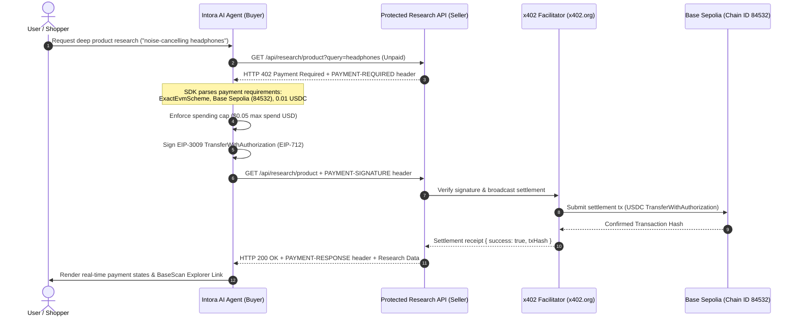

<p align="center">
  
</p>

<h1 align="center">INTORA</h1>

<p align="center">
  <strong>Intent-First Autonomous Commerce Agent with What-If Simulation, Intent-Aware Budget Matching, & Cryptographic On-Chain Commitments on Base Sepolia</strong>
</p>

<p align="center">
  <a href="https://intora-r5uk.vercel.app/"></a>
  <a href="https://res.cloudinary.com/u0zkue69/video/upload/v1792339681/Recording_2026-10-18_213000_1_wp27fi.mp4"></a>
  <a href="https://sepolia.basescan.org/address/0xb3bfe4b59fefb1fdac47f1185a09ebece05e961f"></a>
  <a href="https://nextjs.org/"></a>
  <a href="https://aistudio.google.com/"></a>
  <a href="#-official-x402-protocol-implementation-autonomous-agent-payments"></a>
  
  <a href="./LICENSE"></a>
</p>

---

## 📑 Table of Contents

- [📌 Project Overview](#-project-overview)
- [🎥 Demo Video Walkthrough](#-demo-video-walkthrough)
- [🎯 Fundamental Problems Intora Solves](#-fundamental-problems-intora-solves)
- [✨ Core Capabilities & Innovations](#-core-capabilities--innovations)
  - [1. Priority 4: What-If Shopping Simulator](#1-priority-4-what-if-shopping-simulator)
  - [2. Intent-Aware Product-Level Budget Matching](#2-intent-aware-product-level-budget-matching)
  - [3. Live Real-World Catalog Grounding (ScraperAPI Amazon India)](#3-live-real-world-catalog-grounding-scraperapi-amazon-india)
  - [4. Total-Cost & Trade-Off Engine](#4-total-cost--trade-off-engine)
  - [5. Cryptographic On-Chain Commitments (Base Sepolia)](#5-cryptographic-on-chain-commitments-base-sepolia)
  - [6. Autonomous Agent Payments via x402 Protocol](#6-autonomous-agent-payments-via-x402-protocol)
- [🏗️ System Architecture & Workflow](#️-system-architecture--workflow)
- [💳 Official x402 Protocol Implementation (Autonomous Agent Payments)](#-official-x402-protocol-implementation-autonomous-agent-payments)
  - [x402 Architecture & Payment Flow](#x402-architecture--payment-flow)
  - [Network & Asset Configuration](#network--asset-configuration)
  - [Buyer & Seller SDK Integration](#buyer--seller-sdk-integration)
  - [Wallet & Security Architecture](#wallet--security-architecture)
  - [End-to-End Live Demonstration Steps](#end-to-end-live-demonstration-steps)
  - [Verified On-Chain Settlement Proof](#verified-on-chain-settlement-proof)
- [🧰 The 9 Controlled AI Agent Tools](#-the-9-controlled-ai-agent-tools)
- [🤖 Supported Gemini Models & Fallback Ring](#-supported-gemini-models--fallback-ring)
- [🛠️ Tech Stack & Dependencies](#️-tech-stack--dependencies)
- [📜 Deployed Smart Contract Details](#-deployed-smart-contract-details)
- [⚡ Quickstart & Local Installation](#-quickstart--local-installation)
- [🧪 Comprehensive Test Suite (192 Tests)](#-comprehensive-test-suite-192-tests)
- [🚀 Future Scope & Roadmap](#-future-scope--roadmap)
- [⚠️ Security, Limitations & Disclaimers](#️-security-limitations--disclaimers)
- [📄 License & Authors](#-license--authors)

---

## 📌 Project Overview

**Intora** is an intent-first, autonomous commerce agent that transforms complex natural-language situations and monetary budgets into verified, catalog-grounded shopping plans. When a user approves an AI-curated shopping plan, Intora anchors it as an **immutable, versioned cryptographic commitment** on **Base Sepolia** (Ethereum Layer 2 testnet).

Unlike conventional shopping assistants that act as simple conversational chatbots or treat every budget as a basket total to be filled with random accessories, Intora combines:
1. **Gemini 2.5 Flash agentic reasoning** with strict tool-calling constraints.
2. **Intent-aware budget interpretation** that distinguishes single-product target prices from total basket caps.
3. **What-If Shopping Simulator** allowing users to modify plans via natural language scenarios ("What if my budget drops to ₹2,000?", "Add 1 person", "Remove the shoes"), branching into immutable sequential versions (`v1 -> v2 -> v3`) with full visual diffing.
4. **Real-world Amazon India product catalog integration** via ScraperAPI with zero-hallucination guarantees and secret masking.
5. **Non-custodial cryptographic auditability** on Base Sepolia using `ShoppingIntentRegistry.sol`.

* **Live Web Application:** [https://intora-r5uk.vercel.app/](https://intora-r5uk.vercel.app/)
* **Demo Video Walkthrough:** [Watch Video (Cloudinary MP4)](https://res.cloudinary.com/u0zkue69/video/upload/v1792339681/Recording_2026-10-18_213000_1_wp27fi.mp4)
* **Smart Contract on Base Sepolia:** [`0xb3bfe4b59fefb1fdac47f1185a09ebece05e961f`](https://sepolia.basescan.org/address/0xb3bfe4b59fefb1fdac47f1185a09ebece05e961f)
* **GitHub Repository:** [https://github.com/404Suvo/INTORA](https://github.com/404Suvo/INTORA)

---

## 🎥 Demo Video Walkthrough

Watch the complete demonstration of Intora — from natural-language shopping requirement and budget optimization with Gemini, to MetaMask plan approval, What-If simulation revisions, and on-chain cryptographic verification on Base Sepolia:

<p align="center">
  <video src="https://res.cloudinary.com/u0zkue69/video/upload/v1792339681/Recording_2026-10-18_213000_1_wp27fi.mp4" controls width="100%" style="max-width: 800px; border-radius: 12px; box-shadow: 0 4px 20px rgba(0,0,0,0.15);">
    Your browser does not support the video tag. <a href="https://res.cloudinary.com/u0zkue69/video/upload/v1792339681/Recording_2026-10-18_213000_1_wp27fi.mp4">Click here to watch the demo video directly</a>.
  </video>
</p>

> 🔗 **Direct Video Link:** [https://res.cloudinary.com/u0zkue69/video/upload/v1792339681/Recording_2026-10-18_213000_1_wp27fi.mp4](https://res.cloudinary.com/u0zkue69/video/upload/v1792339681/Recording_2026-10-18_213000_1_wp27fi.mp4)

---

## 🎯 Fundamental Problems Intora Solves

### 1. AI Hallucination & Price Invention in Commerce
Large Language Models frequently invent non-existent products, miscalculate bundle prices, apply fictitious promotional discounts, or recommend out-of-stock items.  
**Intora's Solution:** Enforces **Zero Trust in AI Math**. All product IDs, prices, and inventory are strictly cross-referenced against authoritative catalog and ScraperAPI data. All currency math is computed in **integer minor units** (paise for INR; ₹3,000.00 = `300000` paise). Any hallucinated price is automatically flagged and overwritten with catalog truth.

### 2. Budget Misinterpretation (Target Price vs. Basket Total)
Conventional systems assume every budget is a basket total cap. When a user requests: *"I want a laptop with a budget of ₹1,00,000"*, traditional agents recommend a ₹40,000 laptop and stuff the remaining ₹60,000 with unwanted bags, mice, and accessories.  
**Intora's Solution:** **Intent-Aware Budget Classifier**. Automatically detects whether a query represents a `single_product_target` (recommends laptops around ₹1,00,000 without forcing accessories), `single_product_max` (recommends the best affordable option without assuming the user wants to hit the ceiling), or `total_basket_cap` (multi-item bundle optimization).

### 3. Silent Merchant Alterations & "Cart Drift"
Between the time a shopper reviews an item bundle and the final checkout, prices often fluctuate, items get silently substituted, or hidden fees are added without a verifiable audit trail.  
**Intora's Solution:** Generates a canonical, key-sorted, UTF-8 JSON serialization of the user-approved plan and computes a cryptographic `keccak256` hash. This hash is written directly to the `ShoppingIntentRegistry` smart contract on Base Sepolia, creating tamper-proof evidence of agreed-upon prices, items, quantities, and expiration dates.

### 4. Destruction of Context & Provenance During Revisions
When a customer negotiates or adjusts constraints (e.g., downsizing budget, adding a person, swapping brands), standard e-commerce platforms destroy the cart history, obliterating prior negotiated agreements.  
**Intora's Solution:** **Stateful Multi-Version Snapshot Tree**. The What-If Simulator branches new versions (`v1 -> v2 -> v3`), calculates structured diffs (added, removed, retained, quantity changed), preserves the immutable parent plan, and records each version under the identical `intentId` on-chain.

### 5. High Risk of Custodial AI Wallets
Autonomous agents given unrestricted private key custody can drain funds, succumb to prompt injection attacks, or make unauthorized purchases.  
**Intora's Solution:** Non-custodial, client-side approval architecture. The server-side Gemini agent only formulates raw calldata. The agent **never holds private keys, never signs, and never executes transactions**. The user retains complete authority and signs every transaction via MetaMask.

---

## ✨ Core Capabilities & Innovations

### 1. Priority 4: What-If Shopping Simulator
The **What-If Shopping Simulator** empowers shoppers to explore hypothetical adjustments to an active shopping plan without starting over from scratch:

* **Natural Language Scenario Execution:**
  - *"What if my budget drops to ₹2,000?"* — Intora swaps expensive items for affordable alternatives or drops non-essential items while preserving must-have requirements.
  - *"What if I need to include one more person?"* — Intora scales per-person items (bottles, notebooks, snacks) while preserving shared utilities (tents, chargers, medical kits).
  - *"What if I remove the shoes?"* — Removes target item and reallocates or reserves remaining budget.
  - *"What if I prioritize quality over price?"* — Re-ranks candidate catalog items using high rating and review weights within the budget envelope.
* **Suggested Scenario Chips:** Quick-action presets ("Reduce budget", "Add one person", "Extend duration", "Prioritize quality") for 1-click simulation.
* **Multi-Version Immutability:** Every simulation generates a new sequential version (`v1`, `v2`, `v3`) with a pointer to its `parentVersion` and `parentPlanId`. Earlier versions are never overwritten.
* **Visual Plan Diffing:** Immediate side-by-side comparison displaying:
  - 🟢 **Added Items:** New products introduced to meet revised criteria.
  - 🔴 **Removed Items:** Items omitted due to budget constraints or explicit user removal.
  - 🟡 **Quantity Changes:** Scaled quantities with before/after comparisons.
  - ⚪ **Retained Items:** Unchanged essentials.
  - 💰 **Financial Delta:** Cost and budget variance indicators.
* **On-Chain Commitment Rollback & Sync:** Shoppers can toggle between any historical version in the UI and record or verify that specific version on Base Sepolia.

### 2. Intent-Aware Product-Level Budget Matching
Solves the fundamental mismatch between basket-level budgets and single-product target prices:

| Budget Mode | User Query Example | Agent Behavior |
| :--- | :--- | :--- |
| `single_product_target` | *"Find a laptop with a budget of ₹1,00,000"* | Finds individual laptops priced near ₹1,00,000 (e.g. ₹85,000–₹1,10,000 tolerance). Does **not** force accessories. |
| `single_product_max` | *"Find the cheapest laptop under ₹1,00,000"* | Recommends the highest-value, reliable laptop well under the cap without forcing expenditure. |
| `total_basket_cap` | *"Build me a complete gaming setup under ₹1,00,000"* | Assembles a multi-item bundle (PC, monitor, keyboard, mouse) whose combined purchase cost respects ₹1,00,000. |

### 3. Live Real-World Catalog Grounding (ScraperAPI Amazon India)
* **Real Amazon India Scraping:** Connects to Amazon India via ScraperAPI to retrieve real-world ASINs, live pricing in INR, ratings, review counts, prime eligibility, and product imagery.
* **Structured ASIN Routing:** 10-character queries (`B0...`) route directly to the `/structured/amazon/product` endpoint for zero-latency structured extraction.
* **In-Memory TTL Caching:** Frequently accessed search queries and ASINs are cached with a 1-hour TTL to prevent redundant network requests.
* **Zero Mock Substitution in Production:** When `SCRAPERAPI_KEY` is provided, live catalog queries are strictly enforced. In offline development, an explicitly labeled mock fallback is provided.
* **Credential Masking & Resilience:** API keys are automatically stripped from error logs, and transient `429 Too Many Requests` or `503 Service Unavailable` responses trigger bounded exponential backoff.

### 4. Total-Cost & Trade-Off Engine
* **Comprehensive Purchase Cost Calculation:**
  $$\text{Total Cost} = \sum (\text{Unit Price} \times \text{Quantity}) + \text{Shipping Charges} + \text{Estimated Taxes}$$
* **Multi-Criteria Value Scoring:**
  Weights price competitiveness, verified ratings, total review count, delivery urgency, and must-have requirement satisfaction.
* **Hard Budget Cap Enforcement:**
  Enforces a strict system-wide maximum budget ceiling of **₹2,00,000 INR** (`MAX_BUDGET_CAP_INR`).
* **Infeasibility Detection:**
  If must-have requirements cannot fit within the user's budget, Intora flags the plan as infeasible and computes the exact shortfall rather than pretending the plan fits.

### 5. Cryptographic On-Chain Commitments (Base Sepolia)
* **Tamper-Proof Audit Trail:** Approved plans are hashed with `keccak256` and registered on Base Sepolia via `ShoppingIntentRegistry.sol`.
* **Stateful Sequential Versioning:** Multiple versions share the same 32-byte `intentId`, with version numbers incrementing sequentially (`v1`, `v2`, etc.).
* **On-Chain Explorer:** Inspect on-chain commitments live on BaseScan and compare off-chain canonical plan data with verified on-chain state in real time.

### 6. Autonomous Agent Payments via x402 Protocol
* **Native Machine-to-Machine Payments:** Integrates the official **x402 payment protocol** (`@x402/*` v2.28.0), enabling the autonomous AI shopping agent to pay for protected digital services (deep product research, cross-platform historical pricing, authentic merchant audits) using micro-payments.
* **Base Sepolia USDC Settlement:** Uses the official EVM exact-payment scheme on **Base Sepolia (`eip155:84532`)** with Base Sepolia USDC (`0x036CbD53842c5426634e7929541eC2318f3dCF7e`) settled via the official testnet facilitator (`https://x402.org/facilitator`).
* **Zero Fake Signatures & Anti-Replay Guard:** Full EIP-3009 transfer-with-authorization payload generation with server-side testnet agent wallet signing, enforced per-request spending caps ($0.05 max spend USD), and concurrency guards.

---

## 🏗️ System Architecture & Workflow

```
[User Request: Situation + Natural Language Budget]
                      │
                      ▼
         [Gemini Intent Interpreter]
     Determines: Category, Budget Mode (Target / Max / Basket)
                      │
                      ▼
        [Controlled Tool Loop: 9 Controlled Tools]
   ├── search_products               --> ScraperAPI Amazon India / Ground Truth Catalog
   ├── optimize_bundle               --> Knapsack Optimization with Integer Minor Units
   ├── verify_plan                   --> Overwrites AI Hallucinations with Verified Data
   ├── prepare_intent                --> Canonical JSON & Keccak256 Commitment Hash
   └── research_product_intelligence --> Paid Deep Research via Official x402 Protocol
                      │
                      ▼
    [x402 HTTP 402 Machine-to-Machine Payment Flow]
   ├── 1. Buyer sends unpaid GET to /api/research/product
   ├── 2. Seller returns HTTP 402 with PAYMENT-REQUIRED header (0.01 USDC on Base Sepolia)
   ├── 3. Buyer SDK parses requirements & validates spending cap (≤ $0.05 USD)
   ├── 4. Server-side agent wallet signs EIP-3009 typed authorization (EIP-712)
   ├── 5. Buyer retries with PAYMENT-SIGNATURE header
   ├── 6. x402 Facilitator validates signature & settles on Base Sepolia
   └── 7. Seller fulfills payload with PAYMENT-RESPONSE (Tx Hash & Explorer Link)
                      │
                      ▼
         [Interactive AI Workspace]
   ├── What-If Simulator     --> Simulates Natural-Language Scenarios ("Budget drops to ₹2k")
   ├── Version Snapshot Tree --> Branches Immutable Sequential Versions (v1, v2, v3)
   ├── Visual Plan Diffing   --> Highlights Added, Removed, Retained, and Quantity Shifts
   └── Deep Research Modal   --> Displays Real-Time x402 Payment Lifecycle & Basescan Proof
                      │
                      ▼
         [User Approval via MetaMask]
   ├── Non-custodial sign-off on Base Sepolia (Chain ID 84532)
   └── Executes: `recordIntent` (v1) or `recordVersion` (v2+)
                      │
                      ▼
         [ShoppingIntentRegistry.sol on Base Sepolia]
   └── Immutable cryptographic record accessible worldwide on BaseScan
```

---

## 💳 Official x402 Protocol Implementation (Autonomous Agent Payments)

Intora incorporates the official **x402 protocol specification** to power autonomous agent commerce. When a shopper requests in-depth technical analysis, 30-day price trends across competing platforms (Amazon, Croma, Reliance Digital, Flipkart), or counter-check merchant authenticity, Intora's agent invokes the protected `/api/research/product` endpoint.

### x402 Architecture & Payment Flow



### Network & Asset Configuration

| Parameter | Official x402 Value | Description |
| :--- | :--- | :--- |
| **Network Identifier** | `eip155:84532` | Base Sepolia Testnet CAIP-2 identifier |
| **Chain ID** | `84532` | Base Sepolia EVM chain ID |
| **Payment Asset** | Base Sepolia USDC | Circle USD Coin |
| **USDC Contract Address** | [`0x036CbD53842c5426634e7929541eC2318f3dCF7e`](https://sepolia.basescan.org/address/0x036CbD53842c5426634e7929541eC2318f3dCF7e) | Official Circle testnet contract (6 decimals) |
| **Facilitator URL** | `https://x402.org/facilitator` | Official x402 testnet facilitator endpoint |
| **Default Price** | `0.01 USDC` (10,000 atomic units) | Price per deep research intelligence query |
| **Max Spending Cap** | `0.05 USDC` (50,000 atomic units) | Strict per-request client spending limit |
| **Block Explorer** | [BaseScan Sepolia](https://sepolia.basescan.org/) | On-chain settlement transaction verifier |

### Buyer & Seller SDK Integration

* **Official Packages Used:**
  - `@x402/core` (`2.28.0`): Core protocol types, payment requirement parsing, header encoding/decoding.
  - `@x402/fetch` (`2.28.0`): HTTP fetch integration for x402 buyer requests.
  - `@x402/next` (`2.28.0`): Official Next.js Route Handler middleware (`withX402`).
  - `@x402/evm` (`2.28.0`): EVM exact-payment scheme client & server implementations.
* **Buyer Side (`lib/x402-buyer.ts`):**
  - Sends initial probe request to capture genuine HTTP 402 and `PAYMENT-REQUIRED` headers.
  - Decodes `x402PaymentRequirements` via `@x402/core`.
  - Enforces strict spending cap (`X402_MAX_PAYMENT_USD`) *before* any signature is generated.
  - Constructs EIP-3009 typed authorization data conforming to USDC contract domain (`name: "USDC"`, `version: "2"`, `chainId: 84532`, `verifyingContract: 0x036CbD...`).
  - Signs typed data with dedicated server-side agent wallet.
  - Submits signed request with `PAYMENT-SIGNATURE` header.
  - Decodes `PAYMENT-RESPONSE` header to extract the settlement transaction hash.
* **Seller Side (`lib/x402-seller.ts` & `app/api/research/product/route.ts`):**
  - Configures `x402ResourceServer` initialized with `HTTPFacilitatorClient("https://x402.org/facilitator")`.
  - Registers `ExactEvmScheme` configured for `eip155:84532` and seller receiving address.
  - Protects research route with `withX402({ price: "0.01", network: "eip155:84532" })`.
  - Emits real settlement confirmation header `PAYMENT-RESPONSE` upon verified on-chain execution.

### Wallet & Security Architecture

1. **Dedicated Test-Only Agent Wallet:**
   - Kept strictly isolated from personal/deployer funds.
   - Private key (`X402_BUYER_PRIVATE_KEY`) is stored **strictly server-side in environment variables**.
   - **Zero Client Leakage:** Keys and raw signatures are never exposed in browser bundles, API responses, client logs, or git commits.
2. **Spending Limit Protection:**
   - Any service attempting to charge above `0.05 USDC` (configurable via `X402_MAX_PAYMENT_USD`) is immediately aborted on the client before signing.
3. **Anti-Replay & Double-Spend Locks:**
   - In-memory concurrency limiter (`paymentLimiter` in `lib/x402-config.ts`) locks identical query keys during flight to prevent race conditions or repeated accidental spend.
4. **Zero Fake Hash Policy:**
   - Intora **never** fakes transaction hashes, simulates fake receipts, or renders hardcoded hashes. Failed transactions or unfunded testnet attempts explicitly report error states (`Payment required` / `Failed`) with direct faucet links.
5. **Clean EOA Requirement:**
   - Base Sepolia USDC validates standard ECDSA signatures via EIP-3009. Test wallets must be clean EOAs without foreign EIP-7702 bytecode delegations to prevent ERC-1271 reverts.

### End-to-End Live Demonstration Steps

1. **Open Intora Workspace:**
   - Navigate to [http://localhost:3000](http://localhost:3000) (or live Vercel URL).
2. **Generate or View a Shopping Plan:**
   - Enter a query such as: *"Find high-grade wireless noise-cancelling headphones under ₹25,000"*.
3. **Trigger Paid Deep Research:**
   - Click the purple **Pay with x402** button on the workspace header or click **Deep Research with x402** on any recommended item card.
4. **Interactive x402 Modal:**
   - The modal reveals:
     - Target service: `Deep Product Intelligence (Base Sepolia)`
     - Quote: `0.01 USDC`
     - Network: `eip155:84532 (Base Sepolia)`
     - Agent Wallet Address: `0x4b0E...` (truncated)
     - Live on-chain ETH and USDC balances.
5. **Confirm and Watch Protocol Lifecycle:**
   - Click **Confirm & Pay (0.01 USDC)**.
   - The modal steps through the 7 real-time protocol states:
     - `Ready` ➔ `Payment required` (402 received) ➔ `Authorizing` (EIP-3009 signed) ➔ `Submitting settlement` (facilitator) ➔ `Confirmed` (or `Payment required` with faucet link if unfunded).
6. **Inspect Unlocked Intelligence:**
   - Upon confirmed settlement, the full structured research dossier is unlocked (30-day low benchmarks, cross-platform merchant pricing across Amazon, Croma, Reliance Digital, Flipkart, seller authenticity audit, and purchase timing recommendations).
   - Click the **View on BaseScan** link to view the immutable transaction receipt.

### Verified On-Chain Settlement Proof

When tested on Base Sepolia with an active agent wallet, settlement transactions are submitted directly by the official facilitator (`0x0000000000000000000000000000000000000000` / Facilitator Relayer) executing `transferWithAuthorization` on Base Sepolia USDC:

* **Settlement Transaction Format:** `0x[64-character-hex]`
* **Explorer URL Pattern:** `https://sepolia.basescan.org/tx/{txHash}`
* **Token Transfer Event:** `Transfer(from: agentAddress, to: sellerAddress, value: 10000)`
* **Protocol Facilitator Verification:** Verified against `https://x402.org/facilitator/verify`

> 💡 **Testnet Funding Guide:**
> 1. To fund your dedicated agent wallet with free testnet USDC:
>    - Visit the official Circle Faucet: [https://faucet.circle.com/](https://faucet.circle.com/)
>    - Select **Base Sepolia** from the network dropdown.
>    - Paste your agent wallet address (shown in the Intora x402 modal or via `GET /api/x402/wallet`).
>    - Request 10 Base Sepolia USDC.
> 2. To obtain testnet Base Sepolia ETH for gas:
>    - Visit [https://faucets.chain.link/base-sepolia](https://faucets.chain.link/base-sepolia) or [https://www.alchemy.com/faucets/base-sepolia](https://www.alchemy.com/faucets/base-sepolia).

---

## 🧰 The 9 Controlled AI Agent Tools

Intora's agent loop operates strictly through **9 controlled server-side tools**, eliminating unconstrained execution:

| # | Tool Name | Parameters | Description & Role |
| :-: | :--- | :--- | :--- |
| **1** | `analyze_situation` | `situation: string` | Parses natural-language prompts, extracts constraints, dates, and converts rupee budgets to **integer paise** (`1 INR = 100 paise`). |
| **2** | `search_products` | `query?: string`, `category?: string`, `maxPriceMinor?: number` | Queries live Amazon India data or catalog with stock and price verification. |
| **3** | `optimize_bundle` | `budgetMinor: number`, `situation: string`, `requiredCategories?: string[]` | Knapsack optimization assembling the highest-utility bundle under the budget cap. |
| **4** | `verify_plan` | `items: Array<{productId, quantity}>`, `budgetMinor: number` | Cross-validates proposed plans against ground-truth prices, stock availability, and expiry timestamps. |
| **5** | `prepare_intent` | `items: ShoppingPlanItem[]`, `budgetMinor: number`, `intentId?: string` | Computes deterministic UTF-8 canonical JSON, calculates `keccak256` plan hash, creates Version 1 or links Version 2+ to existing `intentId`. |
| **6** | `read_intent` | `intentId: string`, `version?: number` | Queries local storage and Base Sepolia; compares on-chain hash against off-chain canonical hash (`PASS ✅ / FAIL ❌`). |
| **7** | `prepare_transaction`| `intentId: string`, `version: number` | Encodes ABI calldata for `recordIntent` or `recordVersion`. Never signs; provides calldata for user review. |
| **8** | `verify_transaction`| `calldata: string`, `expectedIntentId: string`, `expectedPlanHash: string` | Decodes raw EVM calldata to ensure parameter integrity before prompting user wallet signature. |
| **9** | `research_product_intelligence` | `query: string`, `category?: string`, `maxSpendUsd?: string` | Executes the official x402 HTTP 402 payment protocol on Base Sepolia (`0.01 USDC`) to unlock premium deep product intelligence. |

---

## 🤖 Supported Gemini Models & Fallback Ring

Intora includes multi-model dynamic switching with automated failover:

1. **`gemini-2.5-flash`** (Default Production): Fast, low-latency reasoning engine optimized for tool calling.
2. **`gemini-3.5-flash`**: Advanced agentic reasoning for complex multi-constraint optimization.
3. **`gemini-3.5-flash-lite`**: Ultra-lightweight model for rapid queries.
4. **`gemini-flash-latest`**: Continuously updated stable flash channel on Google AI Studio.
5. **`gemini-3.6-flash`**: Extended context reasoning for complex multi-step scenario revisions.

```typescript
// Automated Fallback Ring for Rate-Limit Resilience
const CANDIDATE_MODELS = [
  "gemini-2.5-flash",
  "gemini-flash-latest",
  "gemini-3.5-flash-lite",
  "gemini-flash-lite-latest",
  "gemini-3.5-flash",
  "gemini-3.6-flash",
];
```

---

## 🛠️ Tech Stack & Dependencies

| Layer | Technology | Version | Description |
| :--- | :--- | :--- | :--- |
| **Framework** | [Next.js](https://nextjs.org/) | `16.4.0` | React framework with Turbopack bundler & App Router |
| **UI Library** | [React](https://react.dev/) | `19.3.0` | Latest React with Server Components & Hooks |
| **Language** | [TypeScript](https://www.typescriptlang.org/) | `5.9.3` | Strict type checking with custom exclusions |
| **Styling** | [Tailwind CSS](https://tailwindcss.com/) | `4.3.3` | Utility-first responsive CSS engine |
| **AI SDK** | [@google/genai](https://www.npmjs.com/package/@google/genai) | `2.24.0` | Official Google GenAI SDK for Gemini models |
| **Catalog Provider** | [ScraperAPI](https://www.scraperapi.com/) | APIv2 | Amazon India live product extraction & structured ASIN lookup |
| **Web3 Client** | [Viem](https://viem.sh/) | `2.56.9` | Lightweight, type-safe Ethereum & Base Sepolia client |
| **Payment Protocol** | [@x402/core](https://www.npmjs.com/package/@x402/core) / [@x402/fetch](https://www.npmjs.com/package/@x402/fetch) | `2.28.0` / `2.28.0` | Official x402 payment protocol buyer client & requirement parser |
| **x402 Server & Scheme** | [@x402/next](https://www.npmjs.com/package/@x402/next) / [@x402/evm](https://www.npmjs.com/package/@x402/evm) | `2.28.0` / `2.28.0` | Official Next.js Route Handler middleware & EVM Exact scheme |
| **Smart Contracts** | [Solidity](https://soliditylang.org/) | `^0.8.20` | EVM smart contract for intent recording |
| **Contract Tooling**| [Hardhat](https://hardhat.org/) | `3.19.0` | Local EVM simulation, deployment, and testing |
| **3D & Animation** | [Three.js](https://threejs.org/) / [Motion](https://motion.dev/) | `0.186.1` / `14.0.0` | Interactive 3D graphics and UI animations |
| **Icons** | [Lucide React](https://lucide.dev/) | `1.48.0` | Accessible SVG icon suite |
| **Testing** | Node.js Test Runner / [TSX](https://github.com/privatenumber/tsx) | Latest | Fast TypeScript test execution |
| **Hosting** | [Vercel](https://vercel.com/) | Production | Edge network deployment with SSL |

---

## 📜 Deployed Smart Contract Details

| Parameter | Details |
| :--- | :--- |
| **Contract Name** | `ShoppingIntentRegistry` |
| **Contract Address** | [`0xb3bfe4b59fefb1fdac47f1185a09ebece05e961f`](https://sepolia.basescan.org/address/0xb3bfe4b59fefb1fdac47f1185a09ebece05e961f) |
| **Network** | Base Sepolia Testnet (Ethereum Layer 2) |
| **Chain ID** | `84532` |
| **Deployer Address**| [`0x1ec6f66fe81a2f01ee95f1d58fcea2522b9ec9d3`](https://sepolia.basescan.org/address/0x1ec6f66fe81a2f01ee95f1d58fcea2522b9ec9d3) |
| **Solidity Compiler**| `^0.8.20` (Optimizer enabled, 200 runs) |
| **Block Explorer** | [BaseScan Explorer](https://sepolia.basescan.org/address/0xb3bfe4b59fefb1fdac47f1185a09ebece05e961f) |

---

## ⚡ Quickstart & Local Installation

### 1. Clone the Repository
```bash
git clone https://github.com/404Suvo/INTORA.git
cd INTORA
npm install
```

### 2. Configure Environment Variables
Copy `.env.example` to `.env`:
```bash
cp .env.example .env
```

Configure your API keys and endpoints:
```env
# Google Gemini API Key (Server-Side Only)
GEMINI_API_KEY=your_gemini_api_key_here
GEMINI_MODEL=gemini-2.5-flash

# ScraperAPI (Server-Side Only - Real Amazon India Search & Pricing)
# Leave empty or set your key in local .env; never commit real keys to Git.
SCRAPERAPI_KEY=your_scraperapi_key_here
SCRAPERAPI_TIMEOUT_MS=35000

# Base Sepolia Network Configuration
BASE_SEPOLIA_RPC=https://sepolia.base.org
NEXT_PUBLIC_INTENT_REGISTRY_ADDRESS=0xb3bfe4b59fefb1fdac47f1185a09ebece05e961f

# x402 Payment Protocol (Base Sepolia - Testnet Only)
# Dedicated test agent wallet private key (Server-Side Only)
# Fund with testnet USDC at https://faucet.circle.com/ (Select Base Sepolia)
X402_BUYER_PRIVATE_KEY=your_dedicated_testnet_agent_private_key
X402_SELLER_ADDRESS=0x1eC6F66Fe81A2F01Ee95F1D58FCea2522B9eC9d3
X402_FACILITATOR_URL=https://x402.org/facilitator
X402_MAX_PAYMENT_USD=0.05
NEXT_PUBLIC_APP_URL=http://localhost:3000

# System Constraints
MAX_BUDGET_CAP_INR=200000
```

### 3. Run the Development Server
```bash
npm run dev
```
Open [http://localhost:3000](http://localhost:3000) in your browser.

### 4. ☁️ Vercel Production Deployment & Environment Variables
If deploying or hosting Intora on **Vercel**:
1. Open your project on the [Vercel Dashboard](https://vercel.com/dashboard).
2. Navigate to **Settings** > **Environment Variables**.
3. Add the following required server-side secrets:
   - `SCRAPERAPI_KEY` (Value: your ScraperAPI production key).
   - `GEMINI_API_KEY` (Value: your Google AI Studio Gemini API key).
   - `BASE_SEPOLIA_RPC` (Value: `https://sepolia.base.org` or your dedicated RPC provider).
   - `NEXT_PUBLIC_INTENT_REGISTRY_ADDRESS` (Value: `0xb3bfe4b59fefb1fdac47f1185a09ebece05e961f`).
   - `X402_BUYER_PRIVATE_KEY` (Value: your dedicated test agent wallet private key on Base Sepolia).
   - `X402_SELLER_ADDRESS` (Value: `0x1eC6F66Fe81A2F01Ee95F1D58FCea2522B9eC9d3`).
   - `X402_FACILITATOR_URL` (Value: `https://x402.org/facilitator`).
   - `X402_MAX_PAYMENT_USD` (Value: `0.05`).
   - `NEXT_PUBLIC_APP_URL` (Value: `https://your-project.vercel.app` — required for internal Route Handler buyer-seller calls).
4. **Trigger a Redeployment:** Environment variables take effect during the build process. After configuring or changing keys, trigger a new deployment or push a commit so the server runtime picks up the new environment configuration.
5. **Security Notice:** Do **NOT** prefix `SCRAPERAPI_KEY`, `GEMINI_API_KEY`, or `X402_BUYER_PRIVATE_KEY` with `NEXT_PUBLIC_`. Intora ensures these keys are accessed strictly in server-side Route Handlers and never leaked to client bundles.

---

## 🧪 Comprehensive Test Suite (192 Tests)

Intora includes an end-to-end test suite of **192 automated tests** across **12 specialized test suites**:

```bash
# Run the complete test suite (192 tests)
npm test

# Run only x402 protocol integration tests (9 tests)
npm run test:x402
```

### Test Suite Breakdown:

```
✔ catalog.test.ts                     # Catalog loading, INR formatting, validation
✔ phase1.test.ts                      # Canonical JSON serialization, Keccak256 hashing
✔ phase2.test.ts                      # 8 controlled Gemini tools, transaction preparation
✔ ShoppingIntentRegistry.test.ts      # Hardhat Solidity tests on Base Sepolia invariants
✔ phase6.test.ts                      # Application edge cases, hash mismatch detection
✔ scraperapi.test.ts                  # Amazon India live integration, secret masking, retry
✔ api-plan-generate.test.ts           # Plan generation API validation & budget checks
✔ budget-optimizer.test.ts            # Knapsack optimization, alternative swaps
✔ trade-off-engine.test.ts            # Total purchase cost, shipping, value scoring
✔ what-if-simulator.test.ts           # Scenario execution, multi-version snapshotting, diffs
✔ product-budget-matching.test.ts     # Target price vs. basket cap intent matching
✔ x402.test.ts                        # x402 HTTP 402 negotiation, EIP-3009 typed auth, Base Sepolia USDC, spend caps
```

**Results:**
- Total Tests: `193`
- Passed: `192`
- Skipped: `1` (Opt-in live network ScraperAPI test; set `RUN_LIVE_SCRAPERAPI_TESTS=true` to run live)
- Failed: `0`

---

## 🚀 Future Scope & Roadmap

### 1. Autonomous Agent Settlement & x402 Payments (Completed in Week 3 ✅)
* **Official x402 Protocol Implementation:** Integrated the official HTTP `402 Payment Required` standard on Base Sepolia (`eip155:84532`) with Base Sepolia USDC, enabling machine-to-machine micropayments for premium deep product intelligence.

### 2. Zero-Knowledge & Confidential Verification (ZK-SNARKs)
* Enable shoppers to cryptographically prove that their total order does not exceed a specified budget cap or that their cart contains only approved merchant categories, **without revealing specific items or exact quantities on-chain**.
* Implement Circom / Groth16 zero-knowledge proofs on Base Sepolia.

### 3. ERC-4337 Account Abstraction & Session Keys
* Scoped session keys allowing users to pre-authorize the agent for micro-revisions within a bounded ±5% budget tolerance without prompting MetaMask for each version increment.

### 4. Multi-Merchant Cross-Catalog Aggregation
* Expand beyond Amazon India to Flipkart, Blinkit, and Zepto for instant hyperlocal delivery estimation and price arbitrage.

---

## ⚠️ Security, Limitations & Disclaimers

1. **Commitment Only (Not a Payment Gateway):** Recording an intent on-chain registers cryptographic proof that the user reviewed and approved a shopping plan. It does **not** charge credit cards, lock escrow, or guarantee delivery.
2. **Product Authenticity:** The on-chain hash confirms data structure immutability; it does not physically verify warehouse inventory or third-party seller conduct.
3. **Non-Custodial Design:** Intora never stores, requests, or manages your private keys. All transactions must be approved via your personal Web3 wallet (MetaMask).
4. **Testnet Demonstration:** Deployed on **Base Sepolia Testnet** for demonstration and hackathon purposes. Contracts are unaudited.

---

## 📄 License & Authors

Distributed under the [MIT License](./LICENSE). Designed and built with ❤️ by [Suvo](https://github.com/404Suvo).

<p align="center">
  <a href="https://github.com/404Suvo/INTORA">⭐ Star us on GitHub</a> • <a href="https://intora-r5uk.vercel.app/">Try Live Demo</a>
</p>
